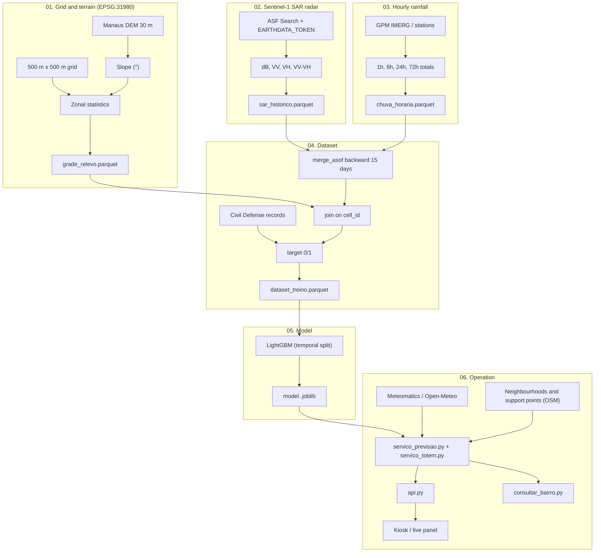

# 🛰️ FRAPC by COSMOS — Flood and landslide alert kiosk for Manaus

**🌐 Language:** **English** · [Português (Brasil)](README.pt-BR.md)

> **NASA Space Apps Challenge 2026 · Manaus** · Challenge *Dancing with the SARs*
> Street kiosks that combine satellite radar, the rain falling right now and a model trained on Civil Defense records
> to tell people, in plain street language, **stay home, get ready or get out — and where to go**.

🎬 [Project video (YouTube)](https://www.youtube.com/watch?v=61hn_QcZrLA) · 📄 [Storytelling Canvas (PT)](as%20pessoas%20que%20vivem%20em%20situa%C3%A7%C3%B5es%20de%20periferia%20e%20ribeirinhos.pdf) · 📄 [5W2H (PT)](5w2h.pdf)

---

## 📌 Contents

1. [The problem and our solution](#-the-problem-and-our-solution)
2. [Quick access: where each part lives](#-quick-access-where-each-part-lives)
3. [Installation](#%EF%B8%8F-installation)
4. [Promo website (`site/`)](#-promo-website-site)
5. [Kiosk app and live panel](#%EF%B8%8F-kiosk-app-and-live-panel)
6. [Backend: REST API (`api.py`)](#%EF%B8%8F-backend-rest-api-apipy)
7. [Command line (`consultar_bairro.py`)](#-command-line-consultar_bairropy)
8. [Data pipeline and model (scripts 01–06)](#-data-pipeline-and-model-scripts-0106)
9. [How the kiosk uses the model](#-how-the-kiosk-uses-the-model)
10. [Project structure](#-project-structure)
11. [Troubleshooting](#-troubleshooting)
12. [Manaus geography at a glance](#%EF%B8%8F-manaus-geography-at-a-glance)

> Code identifiers, file names and API fields are in Portuguese (the team's language). This guide explains each one.

---

## 💡 The problem and our solution

From January to May, the Amazon rainy season fills the streams of Manaus in minutes and soaks hillsides until they give way
(*"terras caídas"*). About **75,000 people** live on high-risk slopes (Census). Optical satellites are blind under constant cloud
cover, and the warning has to reach people who never opened an app.

**FRAPC by COSMOS** is a **vertical street kiosk (1080×1920)** for squares and bus stops. Each kiosk knows which neighbourhood it is in and:

1. **Reads the flood and landslide risk** for its neighbourhood and the ones around it, from a **LightGBM** model trained on terrain
   (DEM), **Sentinel-1 SAR** radar (designed for NASA/ISRO's L-band **NISAR**), hourly rainfall and Civil Defense records.
2. **Shows 4 colour levels**: Calm · Watch · Danger · Extreme.
3. **Says what to do and where to go**: a walking route to a hospital, fire station or safe area **in a neighbourhood that is calm**.
4. Works **without touch** (automatic zoom), **speaks only during alerts** and copes with bad internet.

---

## 🚀 Quick access: where each part lives

After [installation](#%EF%B8%8F-installation), open **two terminals in the project root**:

```bash
# Terminal 1 — backend (API + kiosk app)
python api.py                    # http://localhost:8000

# Terminal 2 — static server for the website
python -m http.server 8080       # http://localhost:8080
```

| Part | Address | Notes |
| :--- | :--- | :--- |
| 🌐 **Promo website** | **http://localhost:8080/site/** | Opens in English. EN / PT-BR switch in the top bar, or `?lang=pt`. |
| 🖥️ **Live panel** (kiosk + test panel + real time) | **http://localhost:8000/app/?lang=en** | Served by the API itself. Without `?lang=en` it opens in Portuguese. |
| 🖥️ Live panel via the static server | http://localhost:8080/index.html?lang=en | What the website's "Live panel ↗" buttons open. Needs the API running for real data. |
| 🖥️ Single kiosk screens | http://localhost:8000/app/deslizamento.html?lang=en · http://localhost:8000/app/alagamento.html?lang=en | Open straight on the landslide (*deslizamento*) or flooding (*alagamento*) screen. |
| ⚙️ **API — interactive docs** | **http://localhost:8000/docs** · http://localhost:8000/redoc | Swagger and ReDoc with every endpoint. |
| ⚙️ API — kiosk payload | http://localhost:8000/totem?lat=-3.1336&lng=-60.0233 | The JSON that feeds a kiosk screen. |
| 🧊 **3D kiosk studio** | open `est_dio_3d_totem_sar_defesa_civil.html` in a browser | Single file, no server needed. |
| 💻 **Command line** | `python consultar_bairro.py --bairro "Centro"` | Risk lookup without a browser. |
| 📄 **Documents** (Portuguese) | `as pessoas que vivem em situações de periferia e ribeirinhos.pdf` · `5w2h.pdf` | Also under "Documents" on the website. |
| 🎬 **Video** | https://www.youtube.com/watch?v=61hn_QcZrLA | Also plays inside the website. Original file: `video nasa apps.mp4`. |

> [!TIP]
> Just want the website? Terminal 2 is enough: the kiosk embedded in the site runs on sample data without the API.
> The "Live panel ↗" buttons also work without the API, showing sample data and a "NO CONNECTION TO THE API" notice.

---

## ⚙️ Installation

### 1. Clone (with Git LFS)

`dados_processados/dataset_treino.parquet` (152 MB) is stored with **Git LFS**. Install [Git LFS](https://git-lfs.com) before cloning:

```bash
git lfs install
git clone https://github.com/Gridissss/FRAPC-by-COSMOS.git
cd FRAPC-by-COSMOS
```

Already cloned without LFS? Run `git lfs pull` to download the real file.

### 2. Python environment

The repository includes the `.venv` folder used during development (**Windows, Python 3.14.7**). It only works on an identical
machine, and its `cacert.pem` certificate files are not on GitHub. **On any other machine, create a fresh environment:**

```bash
# Windows (PowerShell)
Remove-Item -Recurse -Force .venv     # optional: discard the repository's .venv
python -m venv .venv
.\.venv\Scripts\Activate.ps1

# Linux / macOS
rm -rf .venv
python3 -m venv .venv
source .venv/bin/activate

pip install -r requirements.txt
```

### 3. Credentials (optional)

Copy `.env.example` to `.env` and fill it in. **`.env` is never committed to GitHub.**

| Variable | What for | Where to get it |
| :--- | :--- | :--- |
| `METEOMATICS_USERNAME` / `METEOMATICS_PASSWORD` | Real-time rainfall (main source) | https://www.meteomatics.com/en/weather-api/ |
| `EARTHDATA_TOKEN` | Sentinel-1 and GPM IMERG downloads (scripts 02 and 03) | https://urs.earthdata.nasa.gov/users/tokens |
| `INMET_TOKEN` | INMET weather stations (optional) | — |
| `PORT` | API port (default `8000`) | — |

> [!NOTE]
> **Everything works without credentials.** Rainfall automatically falls back to **Open-Meteo** (open, no key) and, offline, to an
> estimated series. Pipeline scripts generate data calibrated to Manaus when no token is set. The trained model
> (`modelos/modelo_alagamento_deslizamento_lgb.joblib`) is already in the repository: no training is needed to use the API.

---

## 🌐 Promo website (`site/`)

Showcase page with the project video, the real kiosk running inside a device mock-up and an explanation of how it works.

- **How to open:** run `python -m http.server 8080` in the project root and go to **http://localhost:8080/site/**. Always use http:
  over `file://`, some browsers (such as VS Code's built-in browser) block the video and the YouTube player.
- **Language:** opens in **English**; the **EN / PT-BR** switch in the top bar changes it (saved in the browser) and `?lang=pt`
  forces Portuguese. English is the HTML itself; Portuguese lives in `site/js/textos-pt.js`, keyed by `data-i18n` (text) and
  `data-i18n-attr="attribute:key"` (alt, aria-label, title…). New text needs a key in both places.
- **Embedded kiosk:** the root `index.html` in **showcase mode** (`index.html?vitrine&lang=…`): no test panel, no voice, sample data from
  `js/dados.js`, so it never shows "no connection" during a presentation. It follows the site language. Scrolling through
  "How it works" changes the kiosk screen, and the "Simulate the rain" buttons change the level (the site talks to the kiosk via `postMessage`).
- **Live panel:** the orange "Live panel ↗" button in the top bar, the shortcut above the kiosk and the main button at the end open the
  official panel (`../index.html?lang=…`) in a new tab, in the same language as the site.
- **Video:** plays inside the page from light versions (`site/assets/video-cosmos.webm` and `.mp4`, ~5 MB each). If neither plays,
  it falls back to YouTube. To regenerate them from the original:
  ```bash
  ffmpeg -i "video nasa apps.mp4" -vf scale=1280:-2 -c:v libx264 -crf 27 -preset slow -pix_fmt yuv420p -c:a aac -b:a 112k -movflags +faststart site/assets/video-cosmos.mp4
  ffmpeg -i "video nasa apps.mp4" -vf scale=1280:-2 -c:v libvpx-vp9 -b:v 0 -crf 37 -row-mt 1 -c:a libopus -b:a 96k site/assets/video-cosmos.webm
  ```
- **Documents:** "Documents" in the top bar and "More details" at the end open a dialog with both PDFs (cover, open and download).
- **Motion:** custom cursor (mouse only), `<canvas>` meshes that react to the cursor and send a radar ripple on click, word-by-word
  headings and a manifesto that lights up as you scroll. With "reduce motion" enabled in the OS, the site stays still and complete.
  Over the kiosk, the site forwards the iframe's mouse events to the page and the kiosk straightens up to face you.
- Illustrative or AI-generated images carry a label saying so.
- **Publishing:** upload the whole project folder to any static host. The site uses `../index.html`, `../js`, `../css` and the root PDFs.
  Without a published API, the live panel shows sample data.

---

## 🖥️ Kiosk app and live panel

The vertical kiosk screen (`index.html`, `css/`, `js/`). Each cycle goes through 9 screens: Today in the city · Landslide ·
Landslide map · Flooding · Flooding map · Next hours · Next days · Go-bag · Get help. Higher-risk screens stay up longer.

### How to open

```bash
python api.py
```

Open **http://localhost:8000/app/?lang=en** (or `index.html` from any server; `js/config.js` points to `http://localhost:8000`).
In the live panel:

- **Test panel** (left, outside the kiosk screen):
  - **Language:** PT-BR / English (saved in the browser).
  - **Real time:** turns the 15-second refresh on or off. While on, the kiosk header shows "● LIVE".
  - **Kiosk location:** click the satellite map or pick a Manaus neighbourhood; "Back to the default location" clears it.
  - **Rain (simulated in the model):** multiplies the real rain (x4, x8, x15) and reruns the model so you can watch the kiosk react.
  - **Screens:** previous, pause and next, or jump straight to any screen.
  - **Levels and forecast scenarios:** force Calm…Extreme for each risk or apply scenarios ("Danger in 1 hour", "Tomorrow only"…).
    Changing a level, scenario or simulation turns real time off and freezes the API so it doesn't overwrite your test.
  - **Sound:** voice and alarm tone.
- **Keyboard and touch:** ← → change screens, space pauses, swiping changes screens, clicking the progress bar jumps to a screen.

### URL parameters

| Parameter | Example | What it does |
| :--- | :--- | :--- |
| `lang` | `?lang=en` | Kiosk language: `pt` (default) or `en`. Text, voice (en-US), dates and numbers switch together. |
| `lat`, `lng`, `local` | `?lat=-3.1085&lng=-60.0455&local=Square%20X` | Where the kiosk is installed (a choice made in the test panel takes priority). |
| `slide` | `?slide=2` | Opens on a given screen (0 = Today in the city). |
| `pausa` | `?pausa` | Freezes the current screen (handy for reviewing the design). |
| `desl`, `alag` | `?desl=4&alag=2` | Opens with this landslide / flooding level (1 to 4). |
| `vitrine` | `?vitrine` | Website mode: no panel, no voice, sample data. |
| `api`, `sufixo`, `tudo` | `?api=api-exemplo&sufixo=.json&tudo=` | Another data source (here, the static JSON files in `api-exemplo/`). |

Fixed settings live in `js/config.js`: API address, default location, refresh interval (60 s, or 15 s in real time), real time on
start (`tempoReal`) and what to do if the API doesn't answer (`exemploSeFalhar`).

### Behaviour

- **Where to go:** a hospital, fire station, Civil Defense post or meeting point in a neighbourhood that is **calm for both risks**,
  with a calm 600 m surrounding area. If a neighbourhood is flooding, its hospital probably is too. If that point is much farther
  (> 2 km and > 1.5× the distance) than a calm neighbourhood, the kiosk sends people to the calm neighbourhood; with none nearby,
  it points to the "calmest area". OSM points that don't handle emergencies (mental-health centres, clinics, vets…) are ignored.
- **Calm** never tells anyone to leave ("No need to leave home"); **watch** shows "If you need to leave"; **danger/extreme**, "Go now to".
- **Map:** Esri World Imagery satellite with streets and names, the neighbourhood outline (OSM) and a walking route (OSRM). No touch:
  it opens zoomed out and, after 3 s, zooms in on the route (or on the neighbourhood itself when everything is calm).
- **Voice** only at watch, danger and extreme; **alarm tone** only at danger and extreme.
- **No API:** shows sample data with "NO CONNECTION TO THE API" and recovers on its own when the API answers.

### Street installation

1. In `js/totem.js`, change `var MANUAL = !VITRINE;` to `var MANUAL = false;` to hide the test panel.
2. Start Chrome in kiosk mode, with audio allowed and the kiosk's coordinates:
   ```bash
   chrome --kiosk --autoplay-policy=no-user-gesture-required "http://SERVER:8000/app/?lat=-3.1085&lng=-60.0455&local=Praça%20do%20Santo%20Antônio"
   ```
3. The screen reloads itself every 10 minutes (at the start of a cycle) and keeps working on a poor connection.

### App language

Translations live in `js/textos-en.js`, keyed by the Portuguese text. In `js/totem.js` every visible string goes through `T("...")`;
new text must go in both. Labels coming from the API ("chuva em 3 dias", "Agora", "Bairro X"…) are translated on screen only,
without changing the API or the model.

---

## ⚙️ Backend: REST API (`api.py`)

A **FastAPI** service that returns the risk for any neighbourhood or coordinate in real time and serves the kiosk screen.

```bash
python api.py                      # http://localhost:8000 (port from PORT, auto-reload)
```

- **Swagger:** http://localhost:8000/docs · **ReDoc:** http://localhost:8000/redoc

| Method | Endpoint | Description |
| :---: | :--- | :--- |
| `GET` | `/` | System status, model metadata and calibrated thresholds. |
| `GET` | `/bairros` | Catalogued Manaus neighbourhoods with zone, coordinates and history. |
| `GET` | `/previsao/{nome_bairro}` | **Real-time risk for a neighbourhood**, with Meteomatics (or Open-Meteo) rainfall. |
| `POST` | `/previsao` | Lookup by coordinate or with simulated rainfall totals. |
| `GET` | `/totem?lat=&lng=` | **Full kiosk payload** (same shape as `js/dados.js`). Optional: `nome` (location name), `fator_chuva` (rain multiplier for simulation) and `atualizar=true` (forces a fresh rain query, at most once a minute per area). |
| `GET` | `/totem/bairros` | Neighbourhoods (name and centre) for the test panel's location picker. |
| `GET` | `/app/` | The kiosk screen served by the API (`/app/deslizamento.html`, `/app/alagamento.html`). |

### Example 1 — real-time lookup

```bash
curl "http://localhost:8000/previsao/Educandos"
```

```json
{
  "bairro": "Educandos",
  "zona_manaus": "Sul",
  "coordenadas": { "latitude": -3.1417, "longitude": -60.0125 },
  "celula_grade": { "cell_id": "cell_01744", "distancia_m": 84.2, "elev_media_m": 43.1, "elev_min_m": 40.7,
                    "declividade_media_graus": 2.1, "declividade_max_graus": 6.2 },
  "dados_meteorologicos": { "fonte": "Meteomatics Weather API (Tempo Real)", "chuva_mm": 0.0, "chuva_acum_1h": 0.0,
                            "chuva_acum_6h": 0.0, "chuva_acum_24h": 0.4, "chuva_acum_72h": 5.4 },
  "radar_sentinel1": { "sar_vv_mean_db": -11.54, "sar_vh_mean_db": -18.14, "sar_diferenca_vv_vh": 6.60 },
  "avaliacao_risco": { "probabilidade_desastre_pct": 0.0, "limiar_decisao_pct": 33.29, "nivel_alerta": "BAIXO",
                       "cor_alerta": "VERDE", "ameaca_predita": "Sem Ocorrência Iminente" }
}
```

Key fields: `celula_grade` = the 500 m grid cell (elevation, slope) · `dados_meteorologicos` = rainfall totals over 1/6/24/72 h ·
`radar_sentinel1` = SAR backscatter · `avaliacao_risco` = probability, decision threshold and alert level (`BAIXO` = low).

### Example 2 — storm simulation

```bash
curl -X POST "http://localhost:8000/previsao" -H "Content-Type: application/json" \
     -d '{"bairro": "São Raimundo", "chuva_acum_1h": 65, "chuva_acum_6h": 110, "chuva_acum_24h": 125, "chuva_acum_72h": 140}'
```

Returns `nivel_alerta: "EMERGÊNCIA MÁXIMA"` (maximum emergency), a ~99.8% probability and
`ameaca_predita: "Risco Misto (Alagamento Urbano e Deslizamento de Encosta)"` (mixed urban flooding and landslide risk), with
recommendations for Civil Defense.

### Example 3 — one kiosk's screen

```bash
curl "http://localhost:8000/totem?lat=-3.1085&lng=-60.0455&nome=Praça%20do%20Santo%20Antônio"
```

Returns the kiosk's neighbourhood and the ones around it (with outlines), the levels now, over the next hours and the next days,
the indicators and the safe destination (`pontoSeguro`) for each risk.

---

## 💻 Command line (`consultar_bairro.py`)

```bash
python consultar_bairro.py --bairro "São Raimundo"                          # one neighbourhood, real-time rain
python consultar_bairro.py --listar                                         # list neighbourhoods
python consultar_bairro.py --bairro "Centro" --simular-chuva-extrema        # stress test
python consultar_bairro.py --todos                                          # the whole city
python consultar_bairro.py --bairro "Centro" --api-url http://localhost:8001 # API at another address
```

The script tries the API first (default `http://localhost:8000`); if it doesn't answer, or when simulating, it uses the local model directly.

---

## 🔬 Data pipeline and model (scripts 01–06)

Processed data and the trained model are already in the repository. Run the scripts **in order** only if you want to rebuild the
pipeline. Each step saves its result as `.parquet`.

| Script | What it does | Output |
| :--- | :--- | :--- |
| `01_grade_relevo.py` | Grid of **4,582 cells of 500×500 m** in `EPSG:31980`, with elevation and slope from the DEM (`dados_brutos/dem_manaus_utm.tif`, or a calibrated synthetic DEM if missing). | `dados_processados/grade_relevo.parquet` |
| `02_coleta_sar.py` | Searches **Sentinel-1 IW GRD_HD** scenes (`asf_search` + `EARTHDATA_TOKEN`), converts to dB and extracts VV, VH and VV−VH per cell. | `dados_processados/sar_historico.parquet` |
| `03_coleta_chuva.py` | Hourly rainfall (NASA GPM IMERG / stations) over 90 days, with 1 h, 6 h, 24 h and 72 h rolling totals. | `dados_processados/chuva_horaria.parquet` |
| `04_montar_dataset.py` | `pd.merge_asof(direction="backward", tolerance=15 days)`: each hour only uses the latest earlier radar pass (no future leakage). Joins Civil Defense records → `target`. | `dados_processados/dataset_treino.parquet` (9.9M rows, via Git LFS) |
| `05_treinar_modelo.py` | **LightGBM** with a temporal 80/20 split and `scale_pos_weight = 176.41` (disasters = 0.56% of hours). | `modelos/modelo_alagamento_deslizamento_lgb.joblib` |
| `06_bairros_pontos_apoio.py` | Neighbourhood polygons and support points (hospitals, fire stations, Civil Defense, meeting points) from OpenStreetMap. | `dados_referencia/*.geojson` |

```bash
python 01_grade_relevo.py
python 02_coleta_sar.py
python 03_coleta_chuva.py
python 04_montar_dataset.py
python 05_treinar_modelo.py
python 06_bairros_pontos_apoio.py
```

**Test metrics (unseen future):** PR-AUC `0.6991` · ROC-AUC `0.9988` · Recall `99.87%` (10,976 of 10,990 disasters) ·
F1 `0.82` at threshold `0.333`.



---

## 🧠 How the kiosk uses the model

The model is used exactly as trained, with no retraining:

- **Rain features in the training windows:** `03_coleta_chuva.py` uses `rolling("Nh", closed="both")`, so an N-hour total sums N+1
  readings (`chuva_acum_1h` = current + previous hour) and `chuva_mm` is the current hour only. The kiosk and `/previsao` compute it the same way.
- **Flooding:** LightGBM probability → 1 (< 20%), 2 (< F1 threshold), 3 (< 65%), 4 (≥ 65%), with a "watch" floor in lowlands
  (elevation ≤ 32 m) at half the training trigger's rainfall.
- **Landslide:** the synthetic DEM never exceeds ~9°, so the training landslide trigger (≥ 16°) never fired and the model didn't learn
  that risk. The kiosk applies the same rule that labelled landslides (72 h ≥ 80 mm and 6 h ≥ 20 mm → danger; 72 h ≥ 120 mm and
  6 h ≥ 40 mm → extreme; 72 h ≥ 50 mm → watch) on slopes (16°, or the steepest 15% of cells on the synthetic DEM). With the real DEM,
  retraining makes the model cover both risks.
- A neighbourhood's level is the level of its worst cell.

---

## 📁 Project structure

```text
FRAPC-by-COSMOS/
├── README.md · README.pt-BR.md          # Documentation (English · Portuguese)
├── requirements.txt · .env.example      # Dependencies and credentials template (.env is never committed)
│
├── 01_grade_relevo.py … 06_bairros_pontos_apoio.py   # Data and model pipeline
├── servico_previsao.py                  # Inference, real-time rain (Meteomatics → Open-Meteo → estimate)
├── servico_totem.py                     # Kiosk payload: neighbourhood, neighbours, horizon, safe destination
├── api.py                               # FastAPI (also serves the kiosk at /app/)
├── consultar_bairro.py                  # Command-line lookup
│
├── index.html · alagamento.html · deslizamento.html · logo.svg   # Kiosk app
├── css/totem.css · css/leaflet.css
├── js/totem.js                          # Screens, map, voice, test panel, real time
├── js/config.js · js/dados.js           # API settings and sample data
├── js/textos-en.js                      # English translation of the kiosk
├── api-exemplo/*.json                   # Static responses for testing without the API
│
├── site/                                # Promo website
│   ├── index.html · css/site.css · js/site.js
│   ├── js/textos-pt.js                  # Portuguese translation of the site
│   └── assets/                          # Logo, images, light video, PDF covers
│
├── est_dio_3d_totem_sar_defesa_civil.html   # 3D kiosk studio
├── *.pdf · video nasa apps.mp4              # Storytelling Canvas, 5W2H and original video
│
├── dados_brutos/                        # Raw data: DEM and Civil Defense records
├── dados_processados/                   # Pipeline parquets (dataset_treino via Git LFS)
├── dados_referencia/                    # Neighbourhoods and support points (GeoJSON, OSM)
├── modelos/                             # Trained LightGBM model
└── .venv/                               # Development environment (Windows, Python 3.14)
```

---

## 🧰 Troubleshooting

| Symptom | Cause and fix |
| :--- | :--- |
| Kiosk shows **"NO CONNECTION TO THE API"** | The API isn't running or is on another port. Run `python api.py` and check `base` in `js/config.js`. |
| **Video won't play** on the site | The site was opened via `file://`. Serve it over http (`python -m http.server 8080`). |
| `dataset_treino.parquet` is only a few bytes | You got the LFS pointer. Run `git lfs install`, then `git lfs pull`. |
| SSL/certificate errors, or `.venv` won't activate | The repository's `.venv` comes from another machine without `cacert.pem`. Create a new one (see [Installation](#2-python-environment)). |
| Port 8000 or 8080 in use | API: `$env:PORT=8001; python api.py` (PowerShell) or `PORT=8001 python api.py` (Linux/macOS), then update `base` in `js/config.js`. Site: `python -m http.server 8081`. |
| Kiosk doesn't speak | Chrome blocks audio without a click: use `--autoplay-policy=no-user-gesture-required`. The voice only speaks at watch, danger and extreme. |
| Rain source is always "Open-Meteo" | No Meteomatics credentials in `.env`; this is expected. |

---

## 🗺️ Manaus geography at a glance

| Parameter | Value | Why |
| :--- | :--- | :--- |
| **Metric CRS** | `EPSG:31980` (SIRGAS 2000 / UTM 20S) | Official standard for Manaus; exact metric area, distance and slope. |
| **Geographic CRS** | `EPSG:4326` (WGS84) | NASA ASF and GPM catalogues and weather APIs. |
| **Urban area** | `lon -60.15 to -59.80 · lat -3.16 to -2.90` | Covers the urban area and the basins of the main streams. |
| **Cell size** | 500 m × 500 m (0.25 km²) | Tactical scale for Civil Defense to isolate blocks and micro-basins. |
| **Flood trigger** | Elevation ≤ 32 m and rain > 35 mm/1 h or > 50 mm/6 h | Overflow of the Mindu, Educandos and São Raimundo streams. |
| **Landslide trigger** | Steep slope and saturation > 80 mm/72 h | Failure of wet slopes in the Alter do Chão Formation. |

---

## 🛡️ License

Developed under the MIT license for the NASA Space Apps Challenge 2026 · Manaus by team **COSMOS**.
Satellite imagery © Esri, Maxar · Maps © OpenStreetMap · Radar data ESA / NASA.
