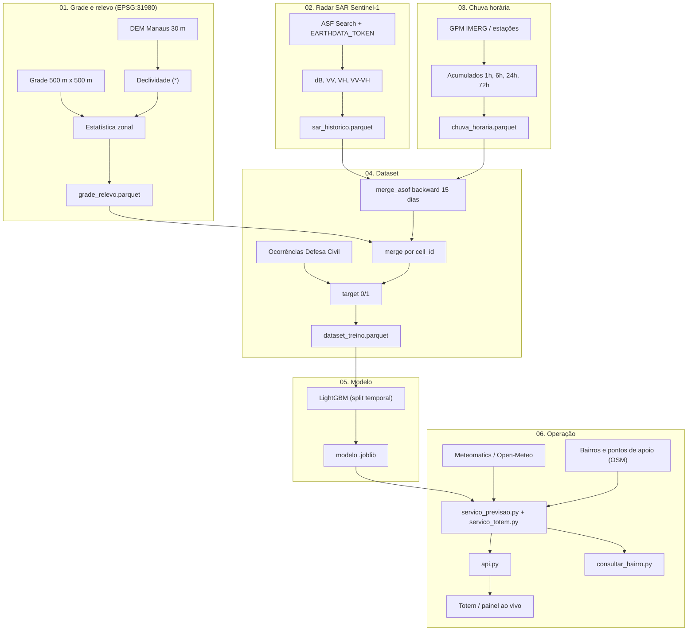

# 🛰️ FRAPC by COSMOS — Totem de alerta de alagamento e deslizamento para Manaus

**🌐 Idioma:** [English](README.md) · **Português (Brasil)**

> **NASA Space Apps Challenge 2026 · Manaus** · Desafio *Dancing with the SARs*
> Totens de rua que cruzam radar de satélite, a chuva de agora e um modelo treinado com ocorrências da Defesa Civil
> para dizer, em linguagem de rua, **fique em casa, fique pronto ou saia — e para onde ir**.

🎬 [Vídeo do projeto (YouTube)](https://www.youtube.com/watch?v=61hn_QcZrLA) · 📄 [Storytelling Canvas](as%20pessoas%20que%20vivem%20em%20situa%C3%A7%C3%B5es%20de%20periferia%20e%20ribeirinhos.pdf) · 📄 [5W2H](5w2h.pdf)

---

## 📌 Sumário

1. [O problema e a solução](#-o-problema-e-a-solução)
2. [Acesso rápido: onde fica cada parte](#-acesso-rápido-onde-fica-cada-parte)
3. [Instalação](#%EF%B8%8F-instalação)
4. [Site de divulgação (`site/`)](#-site-de-divulgação-site)
5. [App do totem e painel ao vivo](#%EF%B8%8F-app-do-totem-e-painel-ao-vivo)
6. [Backend: API REST (`api.py`)](#-backend-api-rest-apipy)
7. [Consulta pelo terminal (`consultar_bairro.py`)](#-consulta-pelo-terminal-consultar_bairropy)
8. [Pipeline de dados e modelo (scripts 01–06)](#-pipeline-de-dados-e-modelo-scripts-0106)
9. [Como o totem usa o modelo](#-como-o-totem-usa-o-modelo)
10. [Estrutura de arquivos](#-estrutura-de-arquivos)
11. [Solução de problemas](#-solução-de-problemas)
12. [Fundamentos geográficos de Manaus](#%EF%B8%8F-fundamentos-geográficos-de-manaus)

---

## 💡 O problema e a solução

Em Manaus, de janeiro a maio, o inverno amazônico enche os igarapés em minutos e encharca o solo das encostas até ele ceder
("terras caídas"). Cerca de **75 mil pessoas** vivem em encostas de alto risco (Censo). Satélites ópticos ficam cegos com a
cobertura de nuvens, e o aviso precisa chegar a quem não abriu aplicativo nenhum.

O **FRAPC by COSMOS** é um **totem vertical (1080×1920)** para praças e paradas de ônibus. Cada totem sabe em que bairro está e:

1. **Lê o risco** de alagamento e de deslizamento do bairro e dos vizinhos, a partir de um modelo **LightGBM** treinado com
   relevo (DEM), radar **SAR Sentinel-1** (projeto pensado para a banda L do **NISAR**, NASA/ISRO), chuva horária e ocorrências da Defesa Civil.
2. **Mostra 4 níveis por cor**: Tranquilo · Atenção · Perigo · Extremo.
3. **Diz o que fazer e para onde ir**: rota a pé até um hospital, bombeiros ou área segura **num bairro que está tranquilo**.
4. Funciona **sem toque** (zoom automático), **fala só em alerta** e aguenta internet ruim.

---

## 🚀 Acesso rápido: onde fica cada parte

Depois da [instalação](#%EF%B8%8F-instalação), abra **dois terminais na raiz do projeto**:

```bash
# Terminal 1 — backend (API + app do totem)
python api.py                    # http://localhost:8000

# Terminal 2 — servidor estático para o site
python -m http.server 8080       # http://localhost:8080
```

| Parte | Endereço | Observação |
| :--- | :--- | :--- |
| 🌐 **Site de divulgação** | **http://localhost:8080/site/** | Abre em inglês. Seletor EN / PT-BR na barra ou `?lang=pt`. |
| 🖥️ **Painel ao vivo** (totem + painel de teste + tempo real) | **http://localhost:8000/app/** | Servido pela própria API. Inglês: `http://localhost:8000/app/?lang=en`. |
| 🖥️ Painel ao vivo pelo servidor estático | http://localhost:8080/index.html | É o que os botões "Live panel ↗" do site abrem. Precisa da API ligada para ter dados reais. |
| 🖥️ Telas diretas do totem | http://localhost:8000/app/deslizamento.html · http://localhost:8000/app/alagamento.html | Abrem já na tela do risco. |
| ⚙️ **API — documentação interativa** | **http://localhost:8000/docs** · http://localhost:8000/redoc | Swagger e ReDoc com todos os endpoints. |
| ⚙️ API — pacote do totem | http://localhost:8000/totem?lat=-3.1336&lng=-60.0233 | JSON que alimenta a tela do totem. |
| 🧊 **Estúdio 3D do totem** | abra `est_dio_3d_totem_sar_defesa_civil.html` no navegador | Arquivo único, não precisa de servidor. |
| 💻 **Terminal** | `python consultar_bairro.py --bairro "Centro"` | Consulta de risco sem navegador. |
| 📄 **Documentos** | `as pessoas que vivem em situações de periferia e ribeirinhos.pdf` · `5w2h.pdf` | Também ficam no botão "Documents" do site. |
| 🎬 **Vídeo** | https://www.youtube.com/watch?v=61hn_QcZrLA | Também toca dentro do site. Original: `video nasa apps.mp4`. |

> [!TIP]
> Só quer ver o site? Basta o terminal 2. O totem embutido no site usa os dados de exemplo e funciona sem a API.
> Os botões "Live panel ↗" também abrem sem a API, mas aí mostram os dados de exemplo com o aviso "SEM CONEXÃO COM A API".

---

## ⚙️ Instalação

### 1. Clonar (com Git LFS)

O `dados_processados/dataset_treino.parquet` (152 MB) fica no **Git LFS**. Instale o [Git LFS](https://git-lfs.com) antes de clonar:

```bash
git lfs install
git clone https://github.com/Gridissss/FRAPC-by-COSMOS.git
cd FRAPC-by-COSMOS
```

Se já clonou sem o LFS, rode `git lfs pull` para baixar o arquivo de verdade.

### 2. Ambiente Python

O repositório inclui a pasta `.venv` usada no desenvolvimento (**Windows, Python 3.14.7**). Ela só funciona em uma máquina igual,
e os certificados `cacert.pem` dela não vão para o GitHub. **Em outra máquina, crie um ambiente novo:**

```bash
# Windows (PowerShell)
Remove-Item -Recurse -Force .venv     # opcional: descarta a .venv do repositório
python -m venv .venv
.\.venv\Scripts\Activate.ps1

# Linux / macOS
rm -rf .venv
python3 -m venv .venv
source .venv/bin/activate

pip install -r requirements.txt
```

### 3. Credenciais (opcional)

Copie `.env.example` para `.env` e preencha. **O `.env` nunca vai para o GitHub.**

| Variável | Para quê | Onde conseguir |
| :--- | :--- | :--- |
| `METEOMATICS_USERNAME` / `METEOMATICS_PASSWORD` | Chuva em tempo real (fonte principal) | https://www.meteomatics.com/en/weather-api/ |
| `EARTHDATA_TOKEN` | Download de cenas Sentinel-1 e GPM IMERG (scripts 02 e 03) | https://urs.earthdata.nasa.gov/users/tokens |
| `INMET_TOKEN` | Estações do INMET (opcional) | — |
| `PORT` | Porta da API (padrão `8000`) | — |

> [!NOTE]
> **Tudo funciona sem credenciais.** A chuva cai automaticamente para a **Open-Meteo** (aberta, sem chave) e, sem internet,
> para uma série estimada. Os scripts do pipeline geram dados calibrados com a dinâmica de Manaus quando não há token.
> O modelo treinado (`modelos/modelo_alagamento_deslizamento_lgb.joblib`) já está no repositório: não é preciso treinar para usar a API.

---

## 🌐 Site de divulgação (`site/`)

Página de apresentação com o vídeo, o totem rodando de verdade dentro de um aparelho e a explicação de como funciona.

- **Como abrir:** `python -m http.server 8080` na raiz e acesse **http://localhost:8080/site/**. Abra sempre por http: pelo
  `file://`, alguns navegadores (como o navegador interno do VS Code) bloqueiam o vídeo e o player do YouTube.
- **Idioma:** abre em **inglês**; o seletor **EN / PT-BR** na barra troca (fica salvo no navegador) e `?lang=pt` força o português.
  O inglês é o próprio HTML; as traduções ficam em `site/js/textos-pt.js`, pelas chaves `data-i18n` (texto) e
  `data-i18n-attr="atributo:chave"` (alt, aria-label, title…). Texto novo precisa de chave nos dois lugares.
- **Totem embutido:** é o `index.html` da raiz em **modo vitrine** (`index.html?vitrine&lang=…`): sem painel de teste, sem voz e com
  os dados de exemplo de `js/dados.js`, então nunca mostra "sem conexão" na apresentação. Ele segue o idioma do site.
  Rolar a seção "How it works" troca a tela do totem, e os botões "Simulate the rain" mudam o nível (o site conversa com o
  totem por `postMessage`).
- **Painel ao vivo:** o botão laranja "Live panel ↗" da barra, o atalho acima do totem e o botão da chamada final abrem o painel
  oficial (`../index.html?lang=…`) numa nova aba, no mesmo idioma do site.
- **Vídeo:** toca dentro da página a partir de versões leves (`site/assets/video-cosmos.webm` e `.mp4`, ~5 MB cada). Se o navegador
  não tocar nenhuma, usa o YouTube. Para regerar a partir do original:
  ```bash
  ffmpeg -i "video nasa apps.mp4" -vf scale=1280:-2 -c:v libx264 -crf 27 -preset slow -pix_fmt yuv420p -c:a aac -b:a 112k -movflags +faststart site/assets/video-cosmos.mp4
  ffmpeg -i "video nasa apps.mp4" -vf scale=1280:-2 -c:v libvpx-vp9 -b:v 0 -crf 37 -row-mt 1 -c:a libopus -b:a 96k site/assets/video-cosmos.webm
  ```
- **Documentos:** "Documents" na barra e "More details" no fim abrem uma janela com os dois PDFs da raiz (capa, abrir e baixar).
- **Movimento:** cursor próprio (com mouse), malhas em `<canvas>` que reagem ao cursor e soltam uma onda de radar no clique,
  títulos palavra por palavra e manifesto que acende com a rolagem. Com "reduzir movimento" ativado no sistema, o site fica
  parado e completo. Sobre o totem, o site repassa o mouse do iframe para a página e o totem se endireita.
- Imagens ilustrativas ou geradas por IA aparecem com selo indicando isso.
- **Publicar:** suba a pasta do projeto inteira em qualquer hospedagem estática. O site usa `../index.html`, `../js`, `../css` e os
  PDFs da raiz. Sem a API publicada, o painel ao vivo mostra os dados de exemplo.

---

## 🖥️ App do totem e painel ao vivo

A tela vertical do totem (`index.html`, `css/`, `js/`). Em cada ciclo ela passa por 9 telas: Hoje na cidade · Deslizamento ·
Mapa do deslizamento · Alagamento · Mapa do alagamento · Próximas horas · Próximos dias · Mochila pronta · Pedir ajuda.
Telas de maior risco ficam mais tempo no ar.

### Como abrir

```bash
python api.py
```

Abra **http://localhost:8000/app/** (ou o `index.html` por qualquer servidor; o `js/config.js` aponta para `http://localhost:8000`).
No painel ao vivo:

- **Painel de teste** (à esquerda, fora da tela do totem):
  - **Idioma:** PT-BR / English (fica salvo no navegador).
  - **Tempo real:** liga e desliga a atualização a cada 15 s. Com ele ligado, o topo do totem mostra "● AO VIVO".
  - **Localização do totem:** clique no mapa de satélite ou escolha um bairro de Manaus; "Voltar ao local padrão" limpa a escolha.
  - **Chuva (simulação no modelo):** multiplica a chuva real (x4, x8, x15) e roda o modelo de novo para ver o totem reagir.
  - **Telas:** anterior, pausar e próxima, além de pular direto para qualquer tela.
  - **Níveis e cenários de previsão:** força Tranquilo…Extremo em cada risco ou aplica cenários ("Perigo em 1 hora", "Só amanhã"…).
    Mexer em nível, cenário ou simulação desliga o tempo real e congela a API para não sobrescrever o teste.
  - **Som:** voz e sinal sonoro.
- **Teclado e toque:** ← → trocam de tela, espaço pausa, deslizar o dedo troca de tela, e clicar na barra de progresso pula para a tela.

### Parâmetros de URL

| Parâmetro | Exemplo | O que faz |
| :--- | :--- | :--- |
| `lang` | `?lang=en` | Idioma do totem: `pt` (padrão) ou `en`. Textos, voz (en-US), datas e números mudam juntos. |
| `lat`, `lng`, `local` | `?lat=-3.1085&lng=-60.0455&local=Praça%20X` | Onde o totem está instalado (a escolha no painel de teste tem prioridade). |
| `slide` | `?slide=2` | Abre direto numa tela (0 = Hoje na cidade). |
| `pausa` | `?pausa` | Congela a tela atual (bom para revisar o visual). |
| `desl`, `alag` | `?desl=4&alag=2` | Abre com esse nível (1 a 4) de deslizamento e alagamento. |
| `vitrine` | `?vitrine` | Modo do site: sem painel, sem voz e com dados de exemplo. |
| `api`, `sufixo`, `tudo` | `?api=api-exemplo&sufixo=.json&tudo=` | Outra fonte de dados (aqui, os JSON estáticos de `api-exemplo/`). |

Configuração fixa em `js/config.js`: endereço da API, local padrão, intervalo de atualização (60 s e 15 s no tempo real),
tempo real ao abrir (`tempoReal`) e o que fazer se a API não responder (`exemploSeFalhar`).

### Comportamento

- **Para onde ir:** hospital, bombeiros, Defesa Civil ou ponto de encontro num bairro **tranquilo nos dois riscos** e com entorno
  de 600 m tranquilo. Se o bairro está alagando, o hospital dele provavelmente também está. Se esse ponto ficar bem mais longe
  (> 2 km e > 1,5× a distância) que um bairro tranquilo, o totem manda para o bairro tranquilo; sem nenhum por perto, indica a
  "área mais tranquila". Pontos do OSM que não atendem emergência (CAPS, UBS, veterinário…) são ignorados.
- **Tranquilo** não manda ninguém sair ("Não precisa sair de casa"); **atenção** mostra "Se precisar sair"; **perigo/extremo**, "Vá agora para".
- **Mapa:** satélite Esri World Imagery com ruas e nomes, contorno do bairro (OSM) e rota a pé (OSRM). Sem toque: abre afastado e,
  depois de 3 s, aproxima no caminho (ou no próprio bairro, quando está tudo tranquilo).
- **Voz** só em atenção, perigo e extremo; **sinal sonoro** só em perigo e extremo.
- **Sem API:** mostra os dados de exemplo com "SEM CONEXÃO COM A API" e volta sozinho quando ela responder.

### Instalação na rua

1. Em `js/totem.js`, troque `var MANUAL = !VITRINE;` por `var MANUAL = false;` para esconder o painel de teste.
2. Abra o Chrome em modo quiosque, com o áudio liberado e a coordenada do totem:
   ```bash
   chrome --kiosk --autoplay-policy=no-user-gesture-required "http://SERVIDOR:8000/app/?lat=-3.1085&lng=-60.0455&local=Praça%20do%20Santo%20Antônio"
   ```
3. A tela recarrega sozinha a cada 10 minutos (no início do ciclo) e segue funcionando com internet ruim.

### Idioma do app

As traduções ficam em `js/textos-en.js`, com o texto em português como chave. No `js/totem.js` todo texto visível passa por
`T("...")`; texto novo precisa entrar nos dois. Os rótulos que chegam da API ("chuva em 3 dias", "Agora", "Bairro X"…) são
traduzidos só na tela, sem mudar a API nem o modelo.

---

## ⚙️ Backend: API REST (`api.py`)

API **FastAPI** que consulta o risco de qualquer bairro ou coordenada em tempo real e serve a tela do totem.

```bash
python api.py                      # http://localhost:8000 (porta em PORT, recarga automática)
```

- **Swagger:** http://localhost:8000/docs · **ReDoc:** http://localhost:8000/redoc

| Método | Endpoint | Descrição |
| :---: | :--- | :--- |
| `GET` | `/` | Status do sistema, metadados do modelo e limiares calibrados. |
| `GET` | `/bairros` | Bairros catalogados de Manaus, com zona, coordenadas e histórico. |
| `GET` | `/previsao/{nome_bairro}` | **Risco do bairro em tempo real** com a chuva da Meteomatics (ou Open-Meteo). |
| `POST` | `/previsao` | Consulta por coordenada ou com volumes de chuva simulados. |
| `GET` | `/totem?lat=&lng=` | **Pacote completo da tela do totem** (formato de `js/dados.js`). Opcionais: `nome` (local), `fator_chuva` (simulação) e `atualizar=true` (força nova consulta da chuva, no máximo 1x por minuto por região). |
| `GET` | `/totem/bairros` | Bairros (nome e centro) para o seletor do painel de teste. |
| `GET` | `/app/` | Tela do totem servida pela própria API (`/app/deslizamento.html`, `/app/alagamento.html`). |

### Exemplo 1 — consulta em tempo real

```bash
curl "http://localhost:8000/previsao/Educandos"
```

```json
{
  "bairro": "Educandos",
  "zona_manaus": "Sul",
  "coordenadas": { "latitude": -3.1417, "longitude": -60.0125 },
  "celula_grade": { "cell_id": "cell_01744", "distancia_m": 84.2, "elev_media_m": 43.1, "elev_min_m": 40.7,
                    "declividade_media_graus": 2.1, "declividade_max_graus": 6.2 },
  "dados_meteorologicos": { "fonte": "Meteomatics Weather API (Tempo Real)", "chuva_mm": 0.0, "chuva_acum_1h": 0.0,
                            "chuva_acum_6h": 0.0, "chuva_acum_24h": 0.4, "chuva_acum_72h": 5.4 },
  "radar_sentinel1": { "sar_vv_mean_db": -11.54, "sar_vh_mean_db": -18.14, "sar_diferenca_vv_vh": 6.60 },
  "avaliacao_risco": { "probabilidade_desastre_pct": 0.0, "limiar_decisao_pct": 33.29, "nivel_alerta": "BAIXO",
                       "cor_alerta": "VERDE", "ameaca_predita": "Sem Ocorrência Iminente" }
}
```

### Exemplo 2 — simulação de tempestade

```bash
curl -X POST "http://localhost:8000/previsao" -H "Content-Type: application/json" \
     -d '{"bairro": "São Raimundo", "chuva_acum_1h": 65, "chuva_acum_6h": 110, "chuva_acum_24h": 125, "chuva_acum_72h": 140}'
```

Retorna `nivel_alerta: "EMERGÊNCIA MÁXIMA"`, probabilidade de ~99,8% e `ameaca_predita: "Risco Misto (Alagamento Urbano e Deslizamento de Encosta)"`, com recomendações para a Defesa Civil.

### Exemplo 3 — tela de um totem

```bash
curl "http://localhost:8000/totem?lat=-3.1085&lng=-60.0455&nome=Praça%20do%20Santo%20Antônio"
```

Devolve o bairro do totem e os vizinhos (com contorno), os níveis de agora, das próximas horas e dos próximos dias, os indicadores
e o `pontoSeguro` de cada risco.

---

## 💻 Consulta pelo terminal (`consultar_bairro.py`)

```bash
python consultar_bairro.py --bairro "São Raimundo"                          # um bairro, chuva em tempo real
python consultar_bairro.py --listar                                         # bairros cadastrados
python consultar_bairro.py --bairro "Centro" --simular-chuva-extrema        # teste de estresse
python consultar_bairro.py --todos                                          # cidade inteira
python consultar_bairro.py --bairro "Centro" --api-url http://localhost:8001 # API em outro endereço
```

O script tenta primeiro a API (padrão `http://localhost:8000`); se ela não responder, ou na simulação, usa o modelo local direto.

---

## 🔬 Pipeline de dados e modelo (scripts 01–06)

Os dados processados e o modelo treinado já estão no repositório. Rode os scripts, **em ordem**, só se quiser refazer o
pipeline. Cada etapa grava o resultado em `.parquet`.

| Script | O que faz | Saída |
| :--- | :--- | :--- |
| `01_grade_relevo.py` | Grade de **4.582 células de 500×500 m** em `EPSG:31980`, com cota e declividade do DEM (`dados_brutos/dem_manaus_utm.tif`, ou DEM sintético calibrado se faltar). | `dados_processados/grade_relevo.parquet` |
| `02_coleta_sar.py` | Busca cenas **Sentinel-1 IW GRD_HD** (`asf_search` + `EARTHDATA_TOKEN`), converte para dB e extrai VV, VH e VV−VH por célula. | `dados_processados/sar_historico.parquet` |
| `03_coleta_chuva.py` | Chuva horária (NASA GPM IMERG / estações) para 90 dias e acumulados móveis de 1 h, 6 h, 24 h e 72 h. | `dados_processados/chuva_horaria.parquet` |
| `04_montar_dataset.py` | `pd.merge_asof(direction="backward", tolerance=15 dias)`: cada hora usa só a última passagem de radar anterior (sem vazamento de futuro). Cruza com as ocorrências da Defesa Civil → `target`. | `dados_processados/dataset_treino.parquet` (9,9 mi linhas, via Git LFS) |
| `05_treinar_modelo.py` | **LightGBM** com split temporal 80/20 e `scale_pos_weight = 176.41` (desastres = 0,56% das horas). | `modelos/modelo_alagamento_deslizamento_lgb.joblib` |
| `06_bairros_pontos_apoio.py` | Polígonos dos bairros e pontos de apoio (hospitais, bombeiros, Defesa Civil, pontos de encontro) do OpenStreetMap. | `dados_referencia/*.geojson` |

```bash
python 01_grade_relevo.py
python 02_coleta_sar.py
python 03_coleta_chuva.py
python 04_montar_dataset.py
python 05_treinar_modelo.py
python 06_bairros_pontos_apoio.py
```

**Métricas no teste (futuro não visto):** PR-AUC `0.6991` · ROC-AUC `0.9988` · Recall `99.87%` (10.976 de 10.990 desastres) ·
F1 `0.82` com limiar `0.333`.



---

## 🧠 Como o totem usa o modelo

O modelo é usado como foi treinado, sem retreinar:

- **Chuva nas mesmas janelas do treino:** `03_coleta_chuva.py` usa `rolling("Nh", closed="both")`, então o acumulado de N horas
  soma N+1 leituras (`chuva_acum_1h` = hora atual + anterior) e `chuva_mm` é só a hora atual. O totem e `/previsao` calculam igual.
- **Alagamento:** probabilidade do LightGBM → 1 (< 20%), 2 (< limiar F1), 3 (< 65%), 4 (≥ 65%), com piso "atenção" em baixio
  (cota ≤ 32 m) e metade da chuva do gatilho do treino.
- **Deslizamento:** o DEM sintético não passa de ~9°, então o gatilho de deslizamento do treino (≥ 16°) nunca ocorreu e o modelo não
  aprendeu esse risco. O totem aplica a mesma regra que rotulou deslizamentos (72 h ≥ 80 mm e 6 h ≥ 20 mm → perigo;
  72 h ≥ 120 mm e 6 h ≥ 40 mm → extremo; 72 h ≥ 50 mm → atenção) nas encostas (16° ou, no DEM sintético, as 15% células mais
  íngremes). Com o DEM real, basta retreinar para o modelo cobrir os dois riscos.
- O nível do bairro é o da sua pior célula.

---

## 📁 Estrutura de arquivos

```text
FRAPC-by-COSMOS/
├── README.md · README.pt-BR.md          # Documentação (inglês · português)
├── requirements.txt · .env.example      # Dependências e modelo de credenciais (.env não vai para o Git)
│
├── 01_grade_relevo.py … 06_bairros_pontos_apoio.py   # Pipeline de dados e modelo
├── servico_previsao.py                  # Inferência, chuva em tempo real (Meteomatics → Open-Meteo → estimada)
├── servico_totem.py                     # Pacote do totem: bairro, vizinhos, horizonte e destino seguro
├── api.py                               # FastAPI (também serve o totem em /app/)
├── consultar_bairro.py                  # Consulta pelo terminal
│
├── index.html · alagamento.html · deslizamento.html · logo.svg   # App do totem
├── css/totem.css · css/leaflet.css
├── js/totem.js                          # Telas, mapa, voz, painel de teste, tempo real
├── js/config.js · js/dados.js           # Configuração da API e dados de exemplo
├── js/textos-en.js                      # Tradução do totem para o inglês
├── api-exemplo/*.json                   # Respostas estáticas para testar sem a API
│
├── site/                                # Site de divulgação
│   ├── index.html · css/site.css · js/site.js
│   ├── js/textos-pt.js                  # Tradução do site para o português
│   └── assets/                          # Logo, imagens, vídeo leve, capas dos PDFs
│
├── est_dio_3d_totem_sar_defesa_civil.html   # Estúdio 3D do totem
├── *.pdf · video nasa apps.mp4              # Storytelling Canvas, 5W2H e vídeo original
│
├── dados_brutos/                        # DEM e ocorrências da Defesa Civil
├── dados_processados/                   # Parquets do pipeline (dataset_treino via Git LFS)
├── dados_referencia/                    # Bairros e pontos de apoio (GeoJSON, OSM)
├── modelos/                             # Modelo LightGBM treinado
└── .venv/                               # Ambiente usado no desenvolvimento (Windows, Python 3.14)
```

---

## 🧰 Solução de problemas

| Sintoma | Causa e solução |
| :--- | :--- |
| Totem mostra **"SEM CONEXÃO COM A API"** | A API não está rodando ou está em outra porta. Rode `python api.py` e confira `base` em `js/config.js`. |
| **Vídeo não toca** no site | O site foi aberto por `file://`. Sirva por http (`python -m http.server 8080`). |
| `dataset_treino.parquet` com poucos bytes | O arquivo veio como ponteiro do LFS. Rode `git lfs install` e depois `git lfs pull`. |
| Erro de SSL/certificado ou a `.venv` não ativa | A `.venv` do repositório é de outra máquina e veio sem os `cacert.pem`. Crie uma nova (veja [Instalação](#2-ambiente-python)). |
| Porta 8000 ou 8080 em uso | API: `$env:PORT=8001; python api.py` (PowerShell) ou `PORT=8001 python api.py` (Linux/macOS), e ajuste `base` em `js/config.js`. Site: `python -m http.server 8081`. |
| Totem não fala | O Chrome bloqueia áudio sem clique: use `--autoplay-policy=no-user-gesture-required`. A voz só fala em atenção, perigo e extremo. |
| Chuva sempre "Open-Meteo" | Sem credenciais da Meteomatics no `.env`; é o comportamento esperado. |

---

## 🗺️ Fundamentos geográficos de Manaus

| Parâmetro | Valor adotado | Justificativa |
| :--- | :--- | :--- |
| **CRS métrico** | `EPSG:31980` (SIRGAS 2000 / UTM 20S) | Padrão oficial para Manaus; cálculos métricos exatos de área, distância e declividade. |
| **CRS geográfico** | `EPSG:4326` (WGS84) | Catálogos da NASA ASF, GPM e APIs de clima. |
| **Área urbana** | `lon -60.15 a -59.80 · lat -3.16 a -2.90` | Cobre a mancha urbana e as bacias dos principais igarapés. |
| **Célula** | 500 m × 500 m (0,25 km²) | Escala tática para a Defesa Civil isolar quarteirões e microbacias. |
| **Gatilho de alagamento** | Cota ≤ 32 m e chuva > 35 mm/1 h ou > 50 mm/6 h | Transbordamento do Mindu, Educandos e São Raimundo. |
| **Gatilho de deslizamento** | Declividade acentuada e saturação > 80 mm/72 h | Ruptura de taludes úmidos na Formação Alter do Chão. |

---

## 🛡️ Licença

Projeto desenvolvido sob licença MIT para o NASA Space Apps Challenge 2026 · Manaus, pela equipe **COSMOS**.
Imagens de satélite © Esri, Maxar · Mapas © OpenStreetMap · Dados de radar ESA / NASA.
